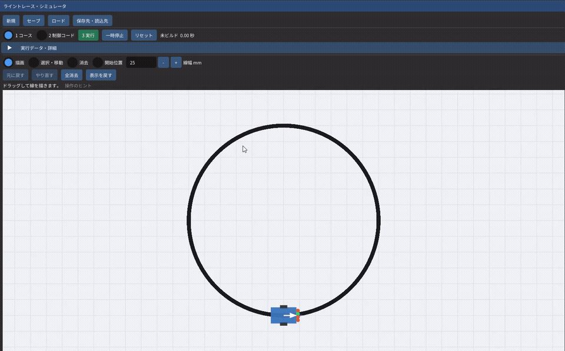

# ライントレース・シミュレータ｜コースを描いてC++で走らせる

手描きのコースをライントレースカーに走らせ、制御コードを変えながら動きを確かめるWindowsアプリを制作しました。Box2Dで車体の運動を計算し、アプリ内でC++を編集・ビルドして、その場で走行に反映できます。

**[15秒の動作ムービーを見る](docs/media/demo.mp4)** — 開発者のWindows PCで実際に描画・実行した画面です。音声なし、末尾のみ静止しています。

## 制作したもの

- **コースエディタ**　マウスで線を描き、線幅や開始位置を変更できます。線の移動・消去、元に戻す操作、コースとコードの保存・読込をまとめました。
- **C++制御の編集と反映**　ラインセンサの値から左右モータの指令を決めます。ビルドしたDLLを再読込するため、アプリ本体を作り直さずに制御則を試せます。
- **物理と走行の確認**　左右の駆動力と横滑り抵抗を車体へ与え、位置・向き・軌跡を表示します。センサ値やモータ指令は、必要なときに詳細欄から確認できます。

## コード検証

このリポジトリでは、アプリの[ソース](src)、[制御コードの例](controller/user_logic.cpp)、[テスト](tests)を公開しています。Windows x64でのビルドと操作は[使い方](docs/usage.md)、物理・センサ・DLLのつながりは[実装の構成](docs/architecture.md)をご覧ください。

開発PCではReleaseビルド、6件の自動試験、コース保存後の再起動・復元・走行を確認しました。[検証記録](docs/verification.md)に条件をまとめています。

## 今後の配布

Windows x64向けに、コンパイラを同梱したZIPをGitHub Releasesで配布する予定です。展開後にEXEを起動すれば、追加インストールなしでC++の編集・ビルドまで使える形を目指しています。現在の公開対象はソースと動作デモです。

使用ライブラリと素材の権利表示は[NOTICE](NOTICE.md)にまとめています。
